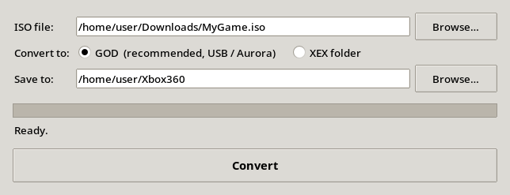

<div align="center">


# Xbox 360 ISO Converter for Linux

**Turn an Xbox 360 ISO into a game your console can run from USB, in three clicks.**




</div>

---

## What it does

| Output | Best for | Result on the USB drive |
| --- | --- | --- |
| **GOD** (Games on Demand) · *recommended* | Aurora, FreeStyle, any USB stick (FAT32 safe) | `Content/0000000000000000/<TitleID>/00007000/…` |
| **XEX** (extracted folder) | XexMenu, launching `default.xex` directly | `Games/<Game name>/default.xex` |

- **Finds your USB drive by itself** and picks the correct folder for the format you choose.
- **Single file, nothing to install.** Python, Tk and the conversion tools are bundled inside the AppImage.
- **Works on most Linux distributions:** Ubuntu 22.04+, Debian 12+, Fedora 35+, Linux Mint 21+, Arch, openSUSE Tumbleweed, and anything else with glibc 2.34 or newer.
- Supports XGD2 and XGD3 images, plus original Xbox ISOs.

## Quick start

1. Download **`Xbox360-ISO-Converter-x86_64.AppImage`** from the [Releases](../../releases) page.
2. Make it executable and run it:

   ```bash
   chmod +x Xbox360-ISO-Converter-x86_64.AppImage
   ./Xbox360-ISO-Converter-x86_64.AppImage
   ```

   Or right-click the file → *Properties* → *Allow executing as program*, then double-click it.
3. Pick your ISO, choose **GOD** or **XEX**, and press **Convert**.

You can also pass the ISO straight away:

```bash
./Xbox360-ISO-Converter-x86_64.AppImage ~/Downloads/MyGame.iso
```

## Playing it on the Xbox 360

1. Plug the USB drive into the console and start your homebrew dashboard (Aurora, FreeStyle, XexMenu…).
2. **GOD:** if the game does not show up in Aurora, add `Usb:\Content\0000000000000000` as a scan path in Aurora's content settings, then rescan.
3. **XEX:** browse to `Usb:\Games\<Game name>\default.xex` and launch it.

> A 32 GB USB stick holds about 3–4 games. Use an external hard drive for a bigger library.

## Build it yourself

```bash
git clone https://github.com/dfsf2151/xbox360-iso-converter.git
cd xbox360-iso-converter
./build-appimage.sh
```

The script downloads prebuilt release binaries (no compiling) and produces `Xbox360-ISO-Converter-x86_64.AppImage` in about a minute.

## Credits

| Project | Used for | License |
| --- | --- | --- |
| [iso2god-rs](https://github.com/iliazeus/iso2god-rs) | ISO → GOD conversion | MIT |
| [extract-xiso](https://github.com/XboxDev/extract-xiso) | ISO extraction | BSD-style |
| [python-appimage](https://github.com/niess/python-appimage) | Bundled Python with Tk | PSF |
| [appimagetool](https://github.com/AppImage/appimagetool) | AppImage packaging | MIT |

---

<div dir="rtl">

## بالعربي

**محوّل ألعاب Xbox 360 للينكس.** يحوّل ملف ISO إلى صيغة **GOD** (المستحسنة للفلاشة و Aurora) أو إلى مجلد **XEX**، بثلاث ضغطات.

- ملف واحد، **ما يحتاج تثبيت**، ويشتغل على أغلب توزيعات لينكس.
- **يكتشف الفلاشة تلقائياً** ويحفظ اللعبة في المسار الصحيح.
- يدعم ألعاب XGD2 و XGD3 وألعاب Xbox الأصلي.

**طريقة الاستخدام:** نزّل الملف من صفحة الإصدارات، اضغط عليه كليك يمين ← خصائص ← اسمح بتشغيله كبرنامج، افتحه، اختر ملف ISO، ثم اضغط **Convert**.

</div>
